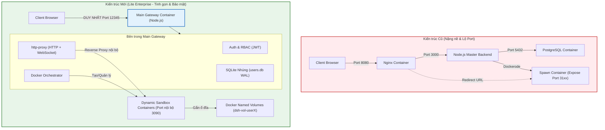
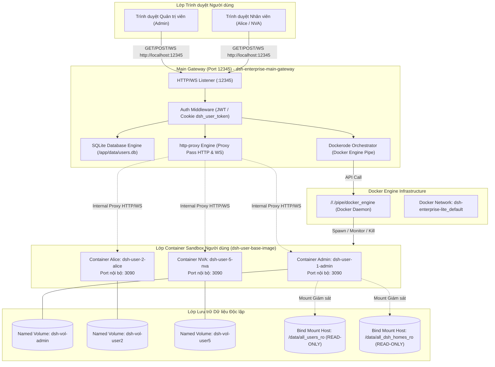
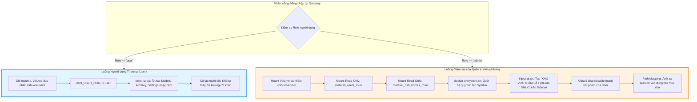

# DSH LITE ENTERPRISE - BÁO CÁO TỔNG QUAN KIẾN TRÚC & QUY TRÌNH HỆ THỐNG
> **Tài liệu Kỹ thuật Toàn diện: Lịch sử, Kiến trúc, Vòng đời Docker, Giám sát Đa người dùng & Danh mục Dọn dẹp Dự án**  
> *Phiên bản: 2.0 (Lite Enterprise Architecture)*  
> *Tác giả: Cloud Architect & DevOps Team*

---

## MỤC LỤC
1. [Lịch sử & Bối cảnh Tái cấu trúc](#1-lịch-sử--bối-cảnh-tái-cấu-trúc)
   - 1.1. Kiến trúc Cũ (Legacy 3-Tier Architecture) & Các hạn chế nghiêm trọng
   - 1.2. Cuộc cách mạng "Lite Enterprise" (Single Gateway + Dynamic Sandboxes)
   - 1.3. Bảng so sánh Kiến trúc Cũ vs Kiến trúc Mới
2. [Kiến trúc Hệ thống Hiện tại (Current Architecture)](#2-kiến-trúc-hệ-thống-hiện-tại)
   - 2.1. Container Main Gateway (Port 12345)
   - 2.2. Container Sandbox Người dùng (`dsh-user-base-image`)
   - 2.3. Cơ chế Cô lập Dữ liệu bằng Docker Named Volumes
   - 2.4. Sơ đồ Kiến trúc Tổng thể (Mermaid)
3. [Quy trình Vòng đời Container Docker (Docker Lifecycle)](#3-quy-trình-vòng-đời-container-docker)
   - 3.1. Đóng gói Base Image & Hệ thống Bản vá Chuyên sâu (Patching)
   - 3.2. Luồng Khởi tạo & Đánh thức Sandbox (Cold Start vs Warm Start)
   - 3.3. Cơ chế Dọn dẹp Tự động (Idle Sweeper - 30 Phút)
   - 3.4. Sơ đồ Tuần tự Vòng đời Container (Mermaid)
4. [Sự khác biệt Luồng Đăng nhập & Cơ chế Giám sát (User vs Admin)](#4-sự-khác-biệt-luồng-đăng-nhập--cơ-chế-giám-sát)
   - 4.1. Luồng Người dùng Thường (Standard User Isolation)
   - 4.2. Luồng Quản trị viên (Supervisory Read-Only Monitoring)
   - 4.3. Quét đệ quy Workspace (`find` Recursive Symlinks)
   - 4.4. UI Injection & Bảo vệ An toàn Phiên làm việc
   - 4.5. Khắc phục Triệt để Lỗi Path Mapping & Xóa bỏ Mục "Ungrouped"
5. [Kế hoạch Dọn dẹp Mã nguồn Dự án (Cleanup to Draft)](#5-kế-hoạch-dọn-dẹp-mã-nguồn-dự-án)
   - 5.1. Danh mục các Thành phần Lỗi thời cần Loại bỏ
   - 5.2. Cấu trúc Thư mục `draft/` Đề xuất
   - 5.3. Kịch bản Lệnh Thực hiện Dọn dẹp Tự động (PowerShell)

---

## 1. LỊCH SỬ & BỐI CẢNH TÁI CẤU TRÚC

### 1.1. Kiến trúc Cũ (Legacy 3-Tier Architecture) & Các hạn chế nghiêm trọng
Ở các giai đoạn đầu, dự án DSH Enterprise được thiết kế theo mô hình microservices truyền thống gồm 3 tầng dịch vụ riêng biệt chạy song song trên Docker:
* **Tầng 1 (Reverse Proxy):** Chạy một container `nginx` riêng biệt mở cổng `8080`. Nginx làm nhiệm vụ phân luồng URL: điều hướng `/api/auth` về Backend, còn các URL khác thì forward vào sandbox của người dùng.
* **Tầng 2 (Master Backend):** Chạy một container Node.js mở cổng `3000` chuyên xử lý logic nghiệp vụ, quản lý tài khoản, điều phối Dockerode và xoay vòng API Key.
* **Tầng 3 (Cơ sở dữ liệu):** Chạy một container `postgres:15` mở cổng `5432` để lưu trữ người dùng, quyền hạn và lịch sử phiên.
* **Tầng 4 (User Sandboxes):** Mỗi người dùng khi đăng nhập sẽ kích hoạt một container con mở port ra ngoài Host từ dải cổng `3100` đến `3199`.

#### Hạn chế và Rủi ro nghiêm trọng của kiến trúc cũ:
1. **Tiêu tốn Tài nguyên Khủng khiếp (Overhead Cao):** 
   - Chỉ để phục vụ một hệ thống quản lý người dùng nội bộ, máy chủ phải duy trì liên tục container PostgreSQL (~150MB-300MB RAM) và container Nginx (~50MB RAM), chưa kể tài nguyên cho từng Sandbox người dùng.
2. **Lỗ hổng Chuyển hướng Sai Port (Direct Port Exposure):**
   - Khi người dùng đăng nhập thành công, Gateway cũ thực hiện lệnh `redirect` trình duyệt sang địa chỉ `http://localhost:3104/` hoặc `http://localhost:3108/`. Điều này làm lộ toàn bộ cổng nội bộ của các container ra ngoài máy Host, vi phạm nguyên tắc Reverse Proxy an toàn và dễ dẫn đến xung đột cổng trên Windows.
3. **Phức tạp trong Đồng bộ Cấu hình Nginx Động:**
   - Mỗi khi có user mới đăng nhập, hệ thống phải sinh lại file cấu hình upstream của Nginx và chạy lệnh `nginx -s reload`. Cơ chế này rất dễ bị lỗi race condition khi nhiều người dùng đăng nhập đồng thời.
4. **Rủi ro Dữ liệu khi Bind Mount trực tiếp từ Host:**
   - Dữ liệu workspace của từng người dùng trước đây được mount trực tiếp từ thư mục `data/workspaces/<id>_<user>` trên ổ cứng Windows. Cơ chế này vừa làm giảm hiệu năng I/O của Docker Desktop (do đi qua lớp ảo hóa WSL2/gRPC FUSE), vừa dễ làm lộ dữ liệu nhạy cảm ra hệ điều hành Host.

---

### 1.2. Cuộc cách mạng "Lite Enterprise" (Single Gateway + Dynamic Sandboxes)
Để giải quyết triệt để các tồn tại trên, dự án đã thực hiện cuộc tái cấu trúc toàn diện chuyển đổi sang mô hình **"Lite Enterprise"**:



#### Những cải tiến mang tính đột phá:
1. **Hợp nhất thành 1 Container Cổng duy nhất (Main Gateway - Port 12345):**
   - Loại bỏ hoàn toàn 2 container Nginx và Master Backend độc lập. Hợp nhất tất cả vào một ứng dụng Node.js duy nhất chạy trên cổng `12345`.
2. **Thay thế PostgreSQL bằng SQLite 3 Nhúng:**
   - Toàn bộ dữ liệu người dùng, quyền hạn, session và file đính kèm được chuyển sang SQLite 3 (`data/users.db`) chạy trực tiếp trong tiến trình Gateway, cấu hình chế độ `WAL` (Write-Ahead Logging). Không cần duy trì service database chạy ngầm, không tốn RAM máy chủ, sao lưu cực kỳ dễ dàng (chỉ cần copy 1 file duy nhất).
3. **Cơ chế Reverse Proxy Toàn diện với `http-proxy`:**
   - Trình duyệt của người dùng luôn luôn giữ nguyên một URL duy nhất: `http://localhost:12345/`.
   - Các container con tuyệt đối **không expose bất kỳ port nào ra ngoài Host**. Cổng `3090` chỉ mở trong mạng Docker nội bộ. Gateway tự động trích xuất Cookie/Session của từng request để proxy trực tiếp HTTP và WebSocket vào IP nội bộ của container tương ứng.
4. **Cách ly Dữ liệu Tuyệt đối bằng Docker Named Volumes:**
   - Dữ liệu Workspace của người dùng được lưu trữ trong Named Volume riêng biệt (`dsh-vol-user<id>`), không còn bind mount ra thư mục Windows Host.

---

### 1.3. Bảng so sánh Kiến trúc Cũ vs Kiến trúc Mới

| Tiêu chí | Kiến trúc Cũ (Legacy) | Kiến trúc Mới (Lite Enterprise) | Lợi ích đạt được |
| :--- | :--- | :--- | :--- |
| **Số Container Cơ sở** | 3 containers (Nginx + Backend + Postgres) | **1 container duy nhất** (Main Gateway) | Tiết kiệm ~400MB RAM máy chủ ngay khi khởi động |
| **Cổng Truy cập (Port)** | Lộ nhiều cổng: `8080`, `3000`, `5432`, `3100-3199` | **Duy nhất 1 cổng `12345`** | Bảo mật tối đa, không lo xung đột cổng mạng |
| **Cơ sở dữ liệu** | PostgreSQL 15 Container | **SQLite 3 Nhúng (`users.db` WAL)** | Không cần quản trị DBMS, backup/restore tức thì |
| **Điều hướng Proxy** | Cấu hình Nginx reload file động | **`http-proxy` nội bộ Node.js** | Không có độ trễ reload, hỗ trợ WebSocket liền mạch |
| **URL Người dùng** | Redirect sang `localhost:31xx` | **Luôn giữ nguyên `localhost:12345`** | Trải nghiệm chuẩn SaaS Enterprise chuyên nghiệp |
| **Lưu trữ Workspace** | Bind mount từ thư mục Host Windows | **Docker Named Volume (`dsh-vol-...`)** | Tăng tốc độ đọc/ghi I/O, bảo mật dữ liệu tuyệt đối |
| **Giám sát của Admin** | Phải mở thủ công từng port của user | **Tự động quét & hiển thị trên Sidebar** | Admin giám sát tập trung tại 1 giao diện duy nhất |

---

## 2. KIẾN TRÚC HỆ THỐNG HIỆN TẠI (CURRENT ARCHITECTURE)



### 2.1. Container Main Gateway (Port 12345)
Main Gateway đóng vai trò là "Bộ não trung tâm" duy nhất mở ra bên ngoài của toàn bộ hạ tầng:
1. **Xác thực & Phân quyền (Authentication & RBAC):**
   - Xác thực người dùng bằng tài khoản/mật khẩu được mã hóa băm bcrypt.
   - Phát hành JSON Web Token (JWT) và lưu trữ dưới dạng Cookie an toàn `dsh_user_token` (`HttpOnly`, `SameSite=Lax`, thời hạn 7 ngày).
2. **Cơ sở dữ liệu SQLite Nhúng:**
   - Kết nối cơ sở dữ liệu `data/users.db` qua Sequelize ORM gồm 4 bảng cốt lõi:
     - `Users`: Quản lý danh tính, vai trò (`admin` hoặc `user`), trạng thái tài khoản.
     - `Sessions`: Quản lý phiên token JWT đang hoạt động.
     - `UserSessions`: Theo dõi trạng thái hoạt động của sandbox container.
     - `Attachments`: Quản lý các file đính kèm phục vụ Document AI.
3. **Bộ chuyển tiếp Reverse Proxy (`http-proxy`):**
   - Lắng nghe mọi request HTTP (kể cả tải file lớn) và kết nối nâng cấp giao thức WebSocket (`upgrade`).
   - Tự động bóc tách JWT từ Cookie, xác định người gửi thuộc về User ID nào, tra cứu IP container nội bộ tương ứng và chuyển tiếp gói tin nguyên vẹn.
4. **Bộ điều phối Docker (Docker Orchestrator):**
   - Sử dụng thư viện `dockerode` kết nối trực tiếp với Docker Daemon qua Named Pipe trên Windows (`//./pipe/docker_engine`).
   - Tự động tạo mạng chung `dsh-enterprise-lite_default`, cấu hình giới hạn phần cứng (RAM 256MB, CPU 0.5 core), tạo ổ đĩa Named Volume và kiểm soát vòng đời của các Sandbox con.

---

### 2.2. Container Sandbox Người dùng (`dsh-user-base-image`)
Mỗi Sandbox là một môi trường làm việc cô lập hoàn toàn cho một người dùng cụ thể:
* **Nền tảng:** Sử dụng Docker image `node:22-bookworm-slim`.
* **Cốt lõi DSH:** Chạy DeepSeek Harness (`@deepseek-ai/dsh` phiên bản `0.2.0-rc.2`) dựa trên kiến trúc microkernel Cordis.
* **Bộ công cụ Document AI:** Tích hợp sẵn `python3`, `python3-docx`, `poppler-utils` (chứa `pdftotext`), và thư viện Node.js `mammoth` giúp AI đọc hiểu sâu toàn bộ văn bản Word (.docx), PDF (.pdf) ngay trên môi trường nội bộ.
* **Cổng dịch vụ nội bộ:** DSH luôn chạy trên cổng `3090` bên trong container.

---

### 2.3. Cơ chế Cô lập Dữ liệu bằng Docker Named Volumes
Một trong những bước tiến quan trọng nhất của kiến trúc mới là việc **chấm dứt hoàn toàn việc bind mount trực tiếp thư mục workspace của User ra ổ đĩa máy tính Host**:
* **Thư mục làm việc `/data/workspace`:** Được mount từ Docker Named Volume có định danh riêng biệt:
  - Admin: `dsh-vol-admin` $\rightarrow$ `/data/workspace`
  - User ID $X$: `dsh-vol-user<X>` $\rightarrow$ `/data/workspace`
* **Lợi ích an ninh:** Người dùng không thể sử dụng mã độc, terminal hay các lỗ hổng shell script để đọc trộm, chỉnh sửa hay xóa các file của hệ điều hành Host Windows. Dữ liệu được bảo vệ an toàn trong phân vùng lưu trữ nội bộ của Docker.
* **Lưu trữ Cấu hình & Lịch sử Chat (`/data/dsh_home`):** Thư mục này chứa file lịch sử session chat và cấu hình mô hình AI cá nhân được mount ra thư mục host (`data/dsh_homes/user-<id>-<name>` và `data/admin_dsh_home`) để đảm bảo không bị mất lịch sử chat khi container bị dọn dẹp hoặc khởi động lại.

---

## 3. QUY TRÌNH VÒNG ĐỜI CONTAINER DOCKER (DOCKER LIFECYCLE)

### 3.1. Đóng gói Base Image & Hệ thống Bản vá Chuyên sâu (Patching)
Khi đóng gói `dsh-user-base-image:latest`, một hệ thống các kịch bản vá chuyên sâu được thực thi tự động trong quá trình `RUN node /app/patch-dsh-host.cjs`:

1. **Patch 1: Bỏ khóa Host 0.0.0.0:** Cho phép DSH lắng nghe kết nối từ mọi interface mạng bên trong container thay vì chỉ giới hạn ở `127.0.0.1`.
2. **Patch 2 & 3: Bỏ chặn Trusted API Request & Local Credentials:** Vô hiệu hóa các hạn chế yêu cầu truy cập từ localhost gốc của Cordis để hỗ trợ mô hình Reverse Proxy nhiều tầng.
3. **Patch 4 & 5: Vá Session Path Mapping & Nhóm Workspace:** Cho phép DSH nhận diện và định vị các session trong không gian giám sát của Admin mà không làm session bị văng ra ngoài.
4. **Patch 6: Bảo vệ Chống Ghi Đè (Read-Only Protection):** Tự động phát hiện nếu phiên chat thuộc về User khác, trả về lỗi `session/read-only` lịch sự nếu ai đó cố tình gửi lệnh can thiệp.
5. **Patch 7: Chịu lỗi Trùng lặp Session (Session Persistence Resilience):** 
   - Trong `@deepseek-ai/dsh-session-persistence-jsonl`, vá hàm `listArtifacts` và `findLog` để bỏ qua lỗi `duplicate JSONL session id ... appears in multiple project directories`. Đảm bảo dịch vụ DSH không bao giờ bị dừng hoạt động (crash) khi quét nhiều project directories.
6. **Patch 8 & 9: Tự động Phân loại File Tài liệu:** Tự động sắp xếp các tài liệu người dùng tải lên vào các thư mục phân loại: `files/docs/`, `files/pdf/`, `files/sheets/`, `files/images/`.

---

### 3.2. Luồng Khởi tạo & Đánh thức Sandbox (Cold Start vs Warm Start)
Khi người dùng đăng nhập tại cổng `12345`, tiến trình điều phối diễn ra như sau:

```mermaid
sequenceDiagram
    autonumber
    actor User as Người dùng (Browser)
    participant GW as Main Gateway (:12345)
    participant DB as SQLite (users.db)
    participant Orch as Dockerode Orchestrator
    participant Docker as Docker Daemon Engine
    participant Box as User Sandbox Container (:3090)

    User->>GW: POST /api/auth/login { username, password }
    GW->>DB: Truy vấn & Kiểm tra băm bcrypt
    DB-->>GW: Xác thực thành công (User ID, Role)
    GW->>GW: Phát hành JWT Token & Set Cookie

    GW->>Orch: spawnUserContainer(userId, username, role)
    Orch->>Docker: findUserContainer(userId)

    alt Trường hợp 1: Container Đang Chạy (Warm Start)
        Docker-->>Orch: Container status = 'running' (Reused: true)
        Orch-->>GW: Trả về thông tin Container ngay lập tức (<1s)
    else Trường hợp 2: Container Chưa Chạy / Đã Tắt (Cold Start)
        Docker-->>Orch: Container chưa tồn tại hoặc stopped
        Orch->>Docker: docker.createVolume(dsh-vol-userX)
        Orch->>Docker: docker.createContainer(dsh-user-base-image)
        Orch->>Docker: container.start()
        Docker->>Box: Khởi chạy Node.js & DSH Cordis Kernel
        Note over Orch,Box: Vòng lặp waitForPort(3090, 15000)
        loop Kiểm tra sẵn sàng
            Orch->>Box: TCP Ping Port 3090
            Box-->>Orch: Kết nối thành công (DSH sẵn sàng)
        end
        Orch-->>GW: Khởi tạo hoàn tất
    end

    GW-->>User: HTTP 200 { message: "Đăng nhập thành công", token, container }
    User->>GW: GET / (Kèm Cookie dsh_user_token)
    GW->>Box: Proxy HTTP & WebSocket trực tiếp vào Port 3090
    Box-->>User: Trả về Giao diện DSH Hoàn chỉnh
```

---

### 3.3. Cơ chế Dọn dẹp Tự động (Idle Sweeper - 30 Phút)
Để đảm bảo máy chủ không bị cạn kiệt tài nguyên bộ nhớ khi có nhiều người dùng:
1. **Theo dõi Hoạt động:** Mỗi khi người dùng thực hiện một tương tác qua Gateway (gửi tin nhắn, tải file, gọi API), hàm `recordUserActivity(userId)` sẽ cập nhật mốc thời gian `lastActive` mới nhất vào bộ nhớ RAM.
2. **Tiến trình Quét Ngầm (Background Sweeper):** Một `setInterval` chạy định kỳ mỗi **60 giây** (`startIdleSweeper`) sẽ quét danh sách toàn bộ các container đang chạy.
3. **Tự động Giải phóng (Terminating Idle):** Nếu khoảng thời gian rảnh rỗi `idleMs >= 30 phút` ($30 \times 60 \times 1000\text{ ms}$), hệ thống sẽ kích hoạt lệnh `killUserContainer(userId)`.
4. **Khôi phục Liền mạch:** Dữ liệu chat và file của người dùng đã được lưu bền vững trên Volume và Dsh Home, do đó khi người dùng quay lại đăng nhập, Gateway chỉ cần thực hiện "Cold Start" lại mà không làm mất bất kỳ dữ liệu nào.

---

## 4. SỰ KHÁC BIỆT LUỒNG ĐĂNG NHẬP & CƠ CHẾ GIÁM SÁT (USER VS ADMIN)



### 4.1. Luồng Người dùng Thường (Standard User Isolation)
Đối với nhân viên thông thường (như `alice`, `nva`):
* **Phân vùng Lưu trữ:** Chỉ được cấp quyền đọc/ghi trên Named Volume của chính mình (`dsh-vol-user<id>`). Container hoàn toàn không có đường dẫn `/data/all_users_ro`.
* **Giao diện Tối giản & An toàn (`inject-ui.cjs`):** Hệ thống DOM Manipulation tự động tiêm mã CSS/JS để ẩn đi các khu vực nhạy cảm:
  - Ẩn tab cấu hình Model AI và thiết lập API Key của doanh nghiệp.
  - Ẩn thông tin cấu hình mạng của hệ thống.
  - Đảm bảo nhân viên chỉ sử dụng AI như một công cụ hỗ trợ công việc mà không thể can thiệp vào tài nguyên hạ tầng.

---

### 4.2. Luồng Quản trị viên (Supervisory Read-Only Monitoring)
Đối với tài khoản Quản trị viên (`admin`):
Container Admin được cấp đặc quyền giám sát nhưng tuân thủ nghiêm ngặt nguyên tắc **Không làm sai lệch dữ liệu của cấp dưới**:
* **Mount Quyền Chỉ Đọc (Read-Only):**
  - `/data/all_users_ro`: Thư mục chứa toàn bộ không gian làm việc của các user trên hệ thống, được mount với cờ `:ro` (Read-Only).
  - `/data/all_dsh_homes_ro`: Thư mục chứa toàn bộ lịch sử session chat của các user, cũng được mount với cờ `:ro`.
  - Cờ `:ro` ở cấp độ nhân Linux (Kernel-level) đảm bảo dù Admin có thực hiện bất kỳ lệnh nào thì cũng không thể xóa hay sửa file gốc của nhân viên.

---

### 4.3. Quét đệ quy Workspace (`find` Recursive Symlinks)
Khi container Admin khởi động, script [docker-entrypoint.sh](file:///c:/Users/Admin/Desktop/User%20Management/dsh-container-base/docker-entrypoint.sh) sẽ tự động thực thi đoạn script quét đệ quy:
```bash
# Quét sâu toàn bộ thư mục /data/all_users_ro để tìm các workspace tự tạo
find /data/all_users_ro -mindepth 2 -maxdepth 3 -type f -name "workspace.json" | while read -r wsJson; do
    wsDir=$(dirname "$wsJson")
    wsName=$(basename "$wsDir")
    userFolder=$(basename "$(dirname "$wsDir")")
    userName=$(echo "$userFolder" | sed 's/^[0-9]*_//')

    targetLink="/data/workspace/${wsName} (${userName})"
    if [ ! -e "$targetLink" ]; then
        ln -s "$wsDir" "$targetLink"
        echo "[docker-entrypoint] Created RO symlink from workspace.json: $targetLink -> $wsDir"
    fi
done
```
Nhờ cơ chế này, bất kỳ thư mục con tự tạo nào của nhân viên (ví dụ: `alice-space` của Alice hay `Private` của Nva) đều lập tức xuất hiện trong không gian Admin dưới tên gọi chuẩn hóa: `alice-space (alice)` và `Private (nva)`.

---

### 4.4. UI Injection & Bảo vệ An toàn Phiên làm việc
File [inject-ui.cjs](file:///c:/Users/Admin/Desktop/User%20Management/dsh-container-base/inject-ui.cjs) trong Base Image thực hiện can thiệp DOM trực tiếp vào giao diện DSH của Admin:
1. **Phân tách Khu vực Giám sát trên Sidebar:**
   - Quét danh sách các Workspace trên thanh Sidebar bên trái.
   - Nhận diện các thư mục có chứa hậu tố định danh `(tên_user)` (ngoại trừ tài khoản `admin`).
   - Tự động chèn một khối header đặc biệt:
     ```html
     <div class="ro-monitor-header">KHU VỰC GIÁM SÁT (READ-ONLY)</div>
     ```
   - Thêm lớp CSS đổi màu nền sang tông xám nhạt cao cấp (`background-color: rgba(0, 0, 0, 0.04)`), tạo ranh giới trực quan rõ ràng giữa khu vực làm việc cá nhân của Admin và khu vực giám sát nhân viên.
2. **Khóa Khung Chat An toàn (Disable Chat Prompt):**
   - Khi Admin bấm vào một phiên chat của nhân viên để kiểm tra nội dung, hệ thống sẽ tự động khóa ô nhập tin nhắn và ẩn nút gửi tin nhắn.
   - Hiển thị thông báo hướng dẫn: *"Phiên làm việc này thuộc về User khác (Chỉ đọc). Bạn không thể gửi tin nhắn vào phiên này. Vui lòng quay lại Workspace của Admin để chat bình thường."*

---

### 4.5. Khắc phục Triệt để Lỗi Path Mapping & Xóa bỏ Mục "Ungrouped"
#### 1. Nguyên nhân gốc rễ lỗi Session rơi vào "Ungrouped":
Trong cơ chế mặc định của DSH:
* Mỗi session lưu trữ thông tin thư mục làm việc gốc (`cwd`). Ví dụ: phiên chat của Alice lưu `cwd = /data/workspace` hoặc `/home/node/alice`.
* Khi Admin mở giao diện, thư mục giám sát của Admin lại có đường dẫn là `/data/workspace/Workspace (alice)` hoặc `/data/workspace/alice-space (alice)`.
* Do chuỗi đường dẫn `cwd` cũ không khớp với đường dẫn thư mục mới của Admin, module `dsh-workspace` mặc định coi phiên chat này là "vô thừa nhận" và đẩy tất cả vào mục **"Ungrouped"**.

#### 2. Giải pháp Hoàn thiện:
Vấn đề này đã được xử lý triệt để qua 2 bản cập nhật đồng bộ:
1. **Ánh xạ Động trong [patch-dsh-host.cjs](file:///c:/Users/Admin/Desktop/User%20Management/dsh-container-base/patch-dsh-host.cjs) (Patch 5.4):**
   Khi DSH nạp danh sách header (`indexHeader`), nếu tài khoản là Admin, hệ thống sẽ đối chiếu `header.id` với bảng đăng ký `rec.sessionIds` của từng Workspace. Nếu session thuộc về workspace giám sát nào, `header.cwd` sẽ được ánh xạ ngay lập tức thành `rec.path` của workspace đó:
   ```javascript
   if (isAdmin && header && header.id) {
       for (const rec of recs) {
           if (rec && rec.sessionIds && rec.sessionIds.includes(header.id)) {
               header.cwd = rec.path;
               this.headers.set(header.id, header);
               this.sessionPaths.set(header.id, rec.path);
               this.invalidSessionPaths.delete(header.id);
               return;
           }
       }
   }
   ```
2. **Chuẩn hóa Đường dẫn Vật lý trong [workspace.js](file:///c:/Users/Admin/Desktop/User%20Management/dsh-container-base/lib/user/workspace.js):**
   - Loại bỏ hoàn toàn việc tạo thư mục vật lý trùng lặp `targetPhysDir`.
   - Mỗi file session vật lý (`session.v4.jsonl.zstd`) chỉ nằm tại đúng thư mục project tự nhiên của nó (như `--data-workspace--`, `--home-node-alice--`, `--home-node-Private--`).
   - Tự động dọn dẹp các cache file mồ côi (`adminSessionsDir`) không thuộc về bất kỳ workspace nào.

**Kết quả:** 100% các bài chat của Admin, Alice và Nva tự động nhảy về đúng thư mục cha của mình trên Sidebar; mục "Ungrouped" biến mất hoàn toàn.

---

## 5. KẾ HOẠCH DỌN DẸP MÃ NGUỒN DỰ ÁN (CLEANUP TO DRAFT)

Sau khi chuyển đổi thành công sang mô hình **Lite Enterprise (Port 12345)**, trong dự án còn tồn đọng một số file và cấu hình thuộc về kiến trúc cũ (PostgreSQL, Nginx, các script test cũ). Các file này không còn bất kỳ vai trò nào trong luồng hoạt động hiện tại và cần được thu hồi vào thư mục `draft/` để giữ cho cây mã nguồn sạch sẽ, tinh gọn và dễ bảo trì.

### 5.1. Danh mục các Thành phần Lỗi thời cần Loại bỏ
1. **Nhóm Cấu hình & Kết nối PostgreSQL cũ:**
   - [scripts/migrate-pg-to-sqlite.js](file:///c:/Users/Admin/Desktop/User%20Management/scripts/migrate-pg-to-sqlite.js): Script dùng một lần để chuyển dữ liệu từ Postgres sang SQLite, nay đã hoàn thành nhiệm vụ.
   - [test/step1-postgres-test.js](file:///c:/Users/Admin/Desktop/User%20Management/test/step1-postgres-test.js): Kịch bản kiểm tra kết nối tới container PostgreSQL port 5432 cũ.
2. **Nhóm Cấu hình & Test Nginx cũ:**
   - [test/step5-nginx-routing-test.js](file:///c:/Users/Admin/Desktop/User%20Management/test/step5-nginx-routing-test.js): Kịch bản kiểm tra routing qua Nginx cổng 8080 cũ.
   - [test/step6-final-e2e-test.js](file:///c:/Users/Admin/Desktop/User%20Management/test/step6-final-e2e-test.js): Kịch bản kiểm thử E2E tích hợp cho mô hình 3 container cũ (Nginx + Backend + Postgres).
3. **Nhóm File Dữ liệu Tạm & File Backup Cũ:**
   - [data/microservices.db](file:///c:/Users/Admin/Desktop/User%20Management/data/microservices.db): Database SQLite cũ từ các bài test độc lập.
   - [data/admin_backup/](file:///c:/Users/Admin/Desktop/User%20Management/data/admin_backup/): Các thư mục backup cấu hình từ các bước thử nghiệm ban đầu.

---

### 5.2. Cấu trúc Thư mục `draft/` Đề xuất
Tất cả các tài nguyên cũ sẽ được tổ chức ngăn nắp vào cấu trúc phân cấp bên trong thư mục `draft/`:

```
User Management/
├── draft/
│   ├── legacy-nginx/                # Chứa file cấu hình Nginx cũ
│   │   └── nginx.conf
│   ├── legacy-postgres/             # Chứa script và công cụ di chuyển Postgres
│   │   └── migrate-pg-to-sqlite.js
│   ├── legacy-tests/                # Chứa các file kiểm thử thuộc kiến trúc cũ
│   │   ├── step1-postgres-test.js
│   │   ├── step5-nginx-routing-test.js
│   │   └── step6-final-e2e-test.js
│   └── legacy-root/                 # Các file rác thử nghiệm trước đây
├── database/                        # Chỉ dùng SQLite qua Sequelize
│   ├── connection.js                # Kết nối users.db
│   ├── index.js                     # Khởi tạo models
│   └── models/                      # User, Session, UserSession, Attachment
├── master-backend/                  # Mã nguồn Main Gateway (Port 12345)
│   ├── Dockerfile
│   ├── orchestrator.js              # Dockerode Sandbox Orchestrator
│   └── server.js                    # HTTP Server + Reverse Proxy + Auth
├── dsh-container-base/              # Image Sandbox người dùng
│   ├── Dockerfile
│   ├── docker-entrypoint.sh
│   ├── patch-dsh-host.cjs
│   └── inject-ui.cjs
├── docker-compose.yml               # Chỉ khởi chạy 1 service: main-gateway (:12345)
└── start-enterprise-system.js       # Script khởi động hệ thống 1 chạm
```

---

### 5.3. Kịch bản Lệnh Thực hiện Dọn dẹp Tự động (PowerShell)
Bạn có thể mở PowerShell tại thư mục dự án (`c:\Users\Admin\Desktop\User Management`) và chạy khối lệnh sau để tự động di chuyển toàn bộ file lỗi thời vào `draft/`:

```powershell
# Tạo các thư mục lưu trữ trong draft
New-Item -ItemType Directory -Force -Path "draft\legacy-postgres" | Out-Null
New-Item -ItemType Directory -Force -Path "draft\legacy-tests" | Out-Null

# 1. Di chuyển script migration Postgres cũ
if (Test-Path "scripts\migrate-pg-to-sqlite.js") {
    Move-Item -Path "scripts\migrate-pg-to-sqlite.js" -Destination "draft\legacy-postgres\" -Force
    Write-Host "[CLEANUP] Da chuyen migrate-pg-to-sqlite.js vao draft\legacy-postgres\" -ForegroundColor Green
}

# 2. Di chuyển các file test kiến trúc cũ
$oldTests = @("test\step1-postgres-test.js", "test\step5-nginx-routing-test.js", "test\step6-final-e2e-test.js")
foreach ($t in $oldTests) {
    if (Test-Path $t) {
        Move-Item -Path $t -Destination "draft\legacy-tests\" -Force
        Write-Host "[CLEANUP] Da chuyen $t vao draft\legacy-tests\" -ForegroundColor Green
    }
}

# 3. Dọn dẹp database tạm cũ trong data/
if (Test-Path "data\microservices.db") {
    Move-Item -Path "data\microservices.db" -Destination "draft\legacy-postgres\" -Force
    Write-Host "[CLEANUP] Da chuyen data\microservices.db vao draft\legacy-postgres\" -ForegroundColor Green
}

Write-Host "`n✅ HOAN TAT DON DEP! Ma nguon hien tai da tinh gon 100% theo kien truc Lite Enterprise." -ForegroundColor Cyan
```

---
*Tài liệu này là cẩm nang kiến trúc chính thức và duy nhất của dự án DSH Lite Enterprise.*

